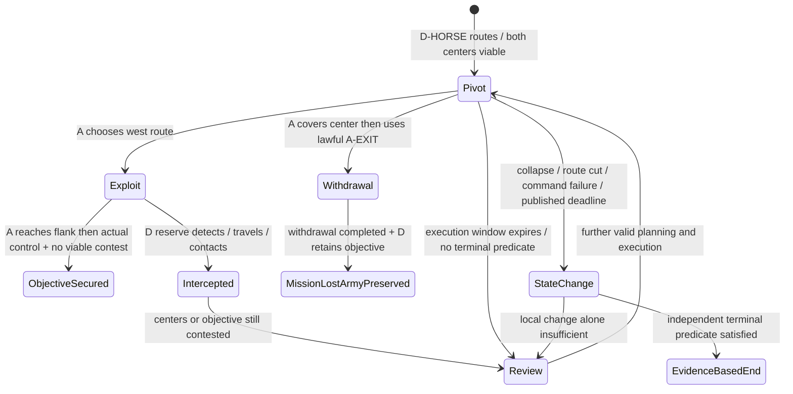

# 07 — انكسار جناح العدو وبقاء القلبين

**G0؛ تصميم لا نتائج محاكاة.** المصدر LOCKED: V3 §5.6.1 و§5.6.3–4، QA07/QA09/QA10/QA21، والتكليف الأخير §12–13. كل عدد وإحداثية وبذرة وعتبة/صيغة في هذه الورقة **PROPOSED fixture-only**، وليست واقعة تاريخية أو ميزانًا معتمدًا. تقرأ مع [الأهداف والنتائج](06-objectives-and-results.md)، [المحرك](03-engine-architecture.md)، [الحالة](04-state-and-commands.md) و[G1A](08-g1a-prototype-brief.md).

<a id="legacy-boundary"></a>
## 1. حدود ما نعرفه

شكوى المالك: كسر جناحًا أيمن ثم خسر بينما جيشه قائم. لا replay/log أصلي لهذه الواقعة ضمن المصادر، ولذلك لا ننسبها لسبب واحد. فحص R الموثق في فهرس السلطة يبين أن legacy يمكن أن ينهي عند انهيار قطاعين، أو قلب بلا احتياط، أو انخفاض الرجال/المعنويات إلى حدود legacy، كما يحسم بالنقاط عند نهاية مراحله/حارس تشغيله. **ليس الادعاء أن كسر جناح واحد وحده ينهي legacy دائمًا.** هذا fixture يختبر عيب الحسم بلا شرط ميداني مشروع، ولا يعيد تمثيل حادثة المالك بوصفها مثبتة.

<a id="map"></a>
## 2. خريطة واحدة وهدف ذو معنى

الإحداثيات بعُشر متر: 10 وحدات = متر؛ x شرقًا، y شمالًا. حدود الخريطة x=0..6000 وy=0..8000 (600×800m، مقترح). facing 0 شمال +y، 64 شرق، 128 جنوب، 192 غرب. الكاميرا وRTL لا يعكسان الجغرافيا. المدافع يتجه جنوبًا؛ **جناحه الأيمن هو غرب الخريطة**.

```text
                           شمال +y
 y8000 ┌──────────────────────────────────────────┐
       │             D-EXIT                       │
 y7400 │ D-BOW                  D-RESERVE بعيد     │
 y6700 │ D-HORSE يمين   D-SPEAR   D-SWORD           │
       │      احتياط قريب في config RESERVE       │
 y5600 │          NORTH-APPROACH                   │
       │ فجوة غربية ← [قمة التل] → مسار شرقي أطول │
 y3800 │             HILL-CROWN                    │
       │                                          │
 y1300 │ A-SWORD        A-SPEAR          A-HORSE    │
 y0850 │               A-BOW                       │
 y0650 │ A-RESERVE                                 │
 y0000 │             A-EXIT                        │
       └──────────────────────────────────────────┘
       x0          2400       3600              6000
```

هندسة fixture (rect = [minX,minY,maxX,maxY]): HILL-CROWN [2400,3800,3600,4800]، NORTH-APPROACH [2400,4800,3600,5600]؛ ارتفاع القمة120dm فوق الأرض؛ يحيط بها مستطيل سفلي [1600,3000,4400,5600] وأربعة منحدرات متصلة شمالًا وجنوبًا وشرقًا وغربًا، مفصلة أدناه. فجوة غرب [1200,3800,2200,5800] مفتوحة، والمسار الشرقي [4200,3000,5200,6000] أطول. مناطق نشر A [600,500,5400,1700] وD [600,6300,5400,7500]؛ المخارج A-EXIT [2300,0,3700,300] وD-EXIT [2300,7700,3700,8000]. لا نهر/حصار في G1A. التل يغير الرؤية/الميل/السرعة والمسار؛ أثره الفيزيائي في [التكتيك](05-tactics-and-terrain.md).

الهدف المنشور للمهاجم: «أمّن قمة التل وممرها الشمالي، مع إبعاد قوة العدو القادرة على منازعتهما». للمدافع: «امنع تأمين الموضعين واحتفظ بقدرة الدفاع؛ نجاح صد الهجوم يُثبت عندما يتخلى المهاجم أو يعجز وفق القواعد». **الاحتلال العابر ليس فوزًا**: يلزم control قانوني للموضعين وغياب contest قانوني قابل للاستمرار بعد انسحاب/انهيار فعلي. تفاصيل قابلية المنازعة/القدرة على الاستمرار PROPOSED في وثيقة06؛ لا score ولا مهلة سرية. نهاية نافذة التنفيذ ليست انتهاء المهمة. ما دام الاحتياط قادرًا على العودة ومواصلة المنازعة، يبقى الهدف غير محقق.


**هندسة ارتفاع مكتملة PROPOSED:** baseHeight عند أول vertex في polygon وفق04؛ الارتفاع=baseHeight+floorDiv(slopeXQ1000·dx+slopeYQ1000·dy,1000). القمة المستطيلة120، والخارج0. south polygon [(1600,3000),(4400,3000),(3600,3800),(2400,3800)] base0/slope(0,150)؛ north [(1600,5600),(2400,4800),(3600,4800),(4400,5600)] base0/slope(0,-150)؛ west [(1600,3000),(2400,3800),(2400,4800),(1600,5600)] base0/slope(150,0)؛ east [(4400,3000),(4400,5600),(3600,4800),(3600,3800)] base0/slope(-150,0). كل800dm ارتفاعه120dm (ميل15% مقترح). الزوايا المشتركة متطابقة الارتفاع فلا حافة عمودية ضمن مسار المركز. الفجوة الغربية ممر قابل للسير يضم طرف المنحدر؛ ليست جميعها أرضًا مستوية ولا تمنح التفافًا مجانيًا.

**نهاية نهار fixture منشورة من البداية، PROPOSED P02:** المواجهتان مثال قرب الغروب؛ كلا config يعلنان `declaredDaylightEndTick=4800` (باقي20 دقيقة وقت محاكاة عند250ms)، و`declaredMissionDeadlineTick=null`. عند انقضاء الضوء تتوقف القدرة على مواصلة قتال فعال حسب قانون هذا الاختبار؛ إن لم يتحقق هدف مستقل قبله أو في التقييم المشترك نفسه تكون النتيجة `completed/unresolved` مع الميدان وفق المواضع والخسائر كاملة. لا ينجح المدافع لمجرد الغروب. نجاح هدف/انسحاب مشروع يمكن أن ينهي قبل ذلك؛ أولًا تُطبق كل أحداث tick4800 ثم تقوّم الأهداف، ثم مسند الصمود عند عدم نجاح هدف. هذه نهاية بيئية معلنة للاختبار، لا مدة إنتاج معتمدة ولا مهلة يختار بعدها فائز. نافذة80tick منفصلة عنها تمامًا؛ فحص عدم التقدم لا يسرع الغروب.
<a id="initial-fixtures"></a>
## 3. الحالات الأولية الثابتة

خمسة تشكيلات لكل طرف: 1,400 مقابل 1,600 **للاختبار فقط**. الفصيل A أموي ضمن سياق 715؛ D قوة مواجهة اختبارية مناسبة للعصر بلا اختراع دولة/شخصية تاريخية. أسماء القادة ثابتة اختبارية A-CMD/D-CMD، لا ادعاء توثيق تاريخي. كل starting عند البداية active؛ بقية خانات الأفراد صفر. morale/cohesion/readiness=800، fatigue=0 (مقياس 0..1000 مقترح)؛ الذخيرة للرماة 30 طلقة/رجل كـfixture، لا قيمة توازن نهائية. لا تعزيزات خارج الرستر.

| ID / الدور | starting | position (dm) | facing | footprint frontage×depth (dm) | القائد/الافتراضي |
|---|---:|---|---:|---|---|
| A-SPEAR / مشاة رماح؛ القلب | 400 | (3000,1300) | 0 | 400×200 | A-CMD؛ hold |
| A-SWORD / مشاة سيوف | 300 | (1900,1300) | 0 | 300×200 | A-LT1؛ hold |
| A-BOW / رماة | 250 | (3000,850) | 0 | 400×150 | A-LT2؛ conserve |
| A-HORSE / فرسان صدمة | 250 | (4400,1200) | 0 | 500×250 | A-LT3؛ hold |
| A-RESERVE / حرس/احتياط | 200 | (1900,650) | 0 | 300×180 | A-LT4؛ keep_reserve |
| D-SPEAR / مشاة رماح؛ القلب | 500 | (3000,6700) | 128 | 500×200 | D-CMD؛ hold |
| D-SWORD / مشاة سيوف | 350 | (4100,6700) | 128 | 350×200 | D-LT1؛ hold |
| D-BOW / رماة | 300 | (3000,7150) | 128 | 450×150 | D-LT2؛ conserve |
| D-HORSE / فرسان صدمة؛ الجناح الأيمن | 250 | (1700,6650) | 128 | 500×250 | D-LT3؛ hold_defend لغطاء الجناح |
| D-RESERVE / حرس/احتياط | 200 | OPEN (4400,7400) / RESERVE (2400,6400) | 128 | 300×180 | D-LT4؛ keep_reserve |

الجدول والصيغة التالية **FixtureSpec** موثق، وليسا ادعاء أنهما BattleState كامل صالح للتشغيل. محول الاختبار المستقبلي يملأ جميع الحقول المطلوبة من schema04 بالافتراضات المعلنة أعلاه، ويرفض حقلًا إلزاميًا بلا قيمة؛ يثبت contentRevision وrulesVersion وRNG ثم ينتج initialStateHash حقيقيًا. لا hash متخيل في G0.

```json
{
  "fixtureSpecVersion": "g0-proposal-1",
  "scenarioId": "umayyad",
  "mapId": "G1A-HILL-FIELD",
  "rulesVersion": "battlev2-g1a-proposed-1",
  "scale": {"unitsPerMetre": 10, "microtickMs": 250},
  "clockRules": {"decisionWindowTicks": 80, "declaredDaylightEndTick": 4800, "declaredMissionDeadlineTick": null},
  "configs": [
    {"fixtureId": "G1A-HILL-OPEN", "seed": 715001, "defenderReservePosition": {"x": 4400, "y": 7400}},
    {"fixtureId": "G1A-HILL-RESERVE", "seed": 715002, "defenderReservePosition": {"x": 2400, "y": 6400}}
  ],
  "initialPersonnelPolicy": "active_equals_starting_other_categories_zero",
  "initialMetrics": {"morale": 800, "cohesion": 800, "readiness": 800, "fatigue": 0},
  "roster": [
    {"id": "A-SPEAR", "sideId": "attacker", "role": "spear_infantry", "starting": 400, "position": {"x": 3000, "y": 1300}},
    {"id": "A-SWORD", "sideId": "attacker", "role": "sword_infantry", "starting": 300, "position": {"x": 1900, "y": 1300}},
    {"id": "A-BOW", "sideId": "attacker", "role": "archers", "starting": 250, "position": {"x": 3000, "y": 850}},
    {"id": "A-HORSE", "sideId": "attacker", "role": "shock_cavalry", "starting": 250, "position": {"x": 4400, "y": 1200}},
    {"id": "A-RESERVE", "sideId": "attacker", "role": "guard_reserve", "starting": 200, "position": {"x": 1900, "y": 650}},
    {"id": "D-SPEAR", "sideId": "defender", "role": "spear_infantry", "starting": 500, "position": {"x": 3000, "y": 6700}},
    {"id": "D-SWORD", "sideId": "defender", "role": "sword_infantry", "starting": 350, "position": {"x": 4100, "y": 6700}},
    {"id": "D-BOW", "sideId": "defender", "role": "archers", "starting": 300, "position": {"x": 3000, "y": 7150}},
    {"id": "D-HORSE", "sideId": "defender", "role": "shock_cavalry", "starting": 250, "position": {"x": 1700, "y": 6650}},
    {"id": "D-RESERVE", "sideId": "defender", "role": "guard_reserve", "starting": 200, "positionRef": "config.defenderReservePosition"}
  ],
  "executionEvidence": "PENDING"
}
```


**قواعد materialization المعلنة لكامل state04 (PROPOSED):** كلا config يرث هذه القيم؛ لا اختيار hidden defaults من محرك مستقبلـي. تستخدم role enums الواردة فيJSON؛ faction A=`umayyad` وD=`fixture_opponent_715` معرف محتوى تجريبي لا فصيل منتج جديد. commanders العشرة في الجدول ordinal0 لكل راية، competence650/style balanced/influence1500، fit ولا إصابة؛ succession لقائد الجانب بالترتيب LT4 ثمLT1 ثمLT2 ثمLT3 المؤهلين؛ كل نائب لا يخلق فردًا جديدًا. experience500، spacing10؛ speeds من جدول05، turnBinsPerTick2، velocity/carry/pathIndex/progress جميعها0؛ elevation تحسب من سطح الموضع وليست0 على التل. الموارد: provisions initial=starting؛ معدات السلاح initial=starting وserviceability900؛ mounted يضيف حصانًا لكل فرد ضمن سجل معدات مستقل؛ ammo30×starting للرماة فقط وصفر للبقية؛ remaining=initial وكل incoming/spent/lost/transferredOut=0. حالة الرايات initial free/organized/nonrouting/notExited؛ orderId يولد ثابتًا من fixtureId+formationId ويحمل hold_defend أوkeep_reserve أوconserve_ammo كما بالجدول، target موقع البداية المعروف، fallback route_blocked→hold، stance مطابق، riskCeiling600. الأوامر الأولية delivered عندtick0 وrevision0، لا رسائل/sealed batches؛ objectives معلنة غير متحققة ومناطقها vacated أولًا. الرؤية الأولية تولد بالـLOS نفسها دون كشف احتياط محجوب.

قواعد عداد الحالة: timers/markers في04 صفر ابتداءً، nextVolleyTick=0 وnextRationTick=14400، eventSequence0 وقناةRNG requests0 وhash للسجل الفارغ يحسبه builder وفق03؛ seed=config.seed هو العدد715001/715002، وnamespace=fixtureId نص معلن، لا digest مختلق. في WING-PIVOT لا تفترض سجلًا قبلtick480: namespace="WING-PIVOT" مستقل، requests0 وtimers/carries0 باستثناءlowOrganizationTicks=8 للرايةD-HORSE المنهارة، nextVolleyTick480 وnextRationTick14880، أوامر الوقفة مستلمة عند480 بهويةcheckpoint، velocity0، وelevation يعاد حسابه. يجزئ loader ordinals ترتيبًا ثابتًا:active أولًا ثمwounded ثمrouted ثمcaptured ثمmissing ثمdead؛ ordinal0 قائد حي في كل الرايات المدرجة. حالات التماس/الاتجاه/القدرة/الأمر تُكتب من جدولpivot؛ الترتيب لا يستنتج سبب إصابة تاريخيًا. التمثيل المصطنع صالح فقط بعد التحقق الكامل؛ الوصول الطبيعي إلى هذه الحالة اختبار آخر PENDING. الحقول المرجعية/hash/content والمخطط تُولد تحققيًا، وأي حقل إلزامي آخر بلا تعريف يجعل fixture غير صالح بدل تخمينه.
تختلف config في seed وموضع احتياط معلوم للمحرك فقط؛ سياسة الخصم واحدة وتعتمد الرصد، لا fixtureId ولا أوامر الإنسان. المقارنة السببية بين الأمرين تعاد أيضًا **داخل config واحدة وبذرة واحدة**؛ مقارنة seedين وحدها لا تعزل أثر الخطة.

<a id="pivot"></a>
## 4. لقطة الانكسار المصطنعة الدقيقة WING-PIVOT

هذه **لقطة اختبار مُدخلة** وليست نتيجة مرصودة للانطلاق السابق. تلزم G1A تجربتان: (1) تحميلها لاختبار oracle عند الحد الحرج؛ (2) اشتقاق حالة مماثلة عبر لعب الحالة الأولية، وتخزين replay الحقيقي/أوامرها إن أمكن. لا توهم اللقطة بأن الضرر الآتي وقع عند tick بعينه في لعبة منفذة.

عند round=6، microtick=480 (120s محاكاة مقترحة في هذه اللقطة)، phase=review: D-HORSE متفرق شمال غرب؛ القلبان متماسكان ويتماسان عند y=4310. هدف القمة contested، الممر الشمالي defender، لا انسحاب جيش مكتمل ولا surrender ولا مهلة مهمة منتهية؛ الغروب المعلن عند4800 ما زال بعيدًا. A-HORSE بلغ الغرب قبل هذه اللقطة المصطنعة؛ اختبار reachability المستقبلي يتحقق أنه يمكنه الوصول بلا teleport. تُحفظ نقطة البداية واللقطة المشتقة كـfixtures مختلفين لا يُخلطان في hash/replay.

الأرقام التالية بالترتيب active / wounded / routed / captured / missing / dead، وهي **أقسام منفصلة** مجموعها starting. routing condition لا تضيف العدد مرة ثانية.

| الراية | position | personnel | cohesion / morale | الحالة والأمر المستلم |
|---|---|---|---|---|
| A-SPEAR | (3000,4210) | 350 / 20 / 0 / 0 / 5 / 25 | 720 / 700 | engaged؛ hold القلب |
| A-SWORD | (2150,4300) | 250 / 20 / 10 / 0 / 0 / 20 | 650 / 680 | covering؛ hold المخرج الغربي |
| A-BOW | (3000,3400) | 230 / 10 / 0 / 0 / 0 / 10 | 780 / 750 | shoot هدف مرصود قانوني أو conserve |
| A-HORSE | (1700,4200) | 190 / 20 / 20 / 0 / 5 / 15 | 620 / 680 | moving؛ جاهز لأمر طريق غربي |
| A-RESERVE | (1900,3200) | 180 / 10 / 0 / 0 / 0 / 10 | 800 / 800 | keep_reserve |
| D-SPEAR | (3000,4410) | 450 / 25 / 0 / 0 / 5 / 20 | 700 / 720 | engaged؛ hold القلب |
| D-SWORD | (4000,4400) | 300 / 25 / 0 / 0 / 5 / 20 | 680 / 700 | hold؛ قابل للتحرك القانوني |
| D-BOW | (3000,5250) | 270 / 20 / 0 / 0 / 0 / 10 | 760 / 730 | shoot/conserve |
| D-HORSE | (1700,5200) | 20 / 20 / 180 / 0 / 10 / 20 | 120 / 150 | routing شمالًا؛ لا قوات سحرية |
| D-RESERVE | OPEN (4400,6250) / RESERVE (2400,5700) | 180 / 10 / 0 / 0 / 0 / 10 | 800 / 800 | keep_reserve؛ لم يصل بعد |

A=1200 active +80 wounded +30 routed +0 captured +10 missing +80 dead =1400. D=1220+100+180+0+20+80=1600. حالة المركز لا تختزل في عدد؛ موضعه وتماسكه وأمره وإمكان الفعل تحقق viableCenter وفق قواعد05 المقترحة.

```json
{
  "fixtureId": "WING-PIVOT",
  "kind": "synthetic_checkpoint_spec",
  "baseFixtureId": "G1A-HILL-OPEN",
  "seed": 715001,
  "timing": {"round": 6, "microtick": 480, "phase": "review"},
  "objectiveSnapshot": {"HILL-CROWN": "contested", "NORTH-APPROACH": "defender", "fulfilled": []},
  "withdrawalsCompleted": [],
  "technicalInterruption": false,
  "formations": [
    {"id": "A-SPEAR", "position": {"x": 3000, "y": 4210}, "personnel": {"starting": 400, "active": 350, "wounded": 20, "routed": 0, "captured": 0, "missing": 5, "dead": 25}, "cohesion": 720, "morale": 700},
    {"id": "D-SPEAR", "position": {"x": 3000, "y": 4410}, "personnel": {"starting": 500, "active": 450, "wounded": 25, "routed": 0, "captured": 0, "missing": 5, "dead": 20}, "cohesion": 700, "morale": 720},
    {"id": "D-HORSE", "position": {"x": 1700, "y": 5200}, "personnel": {"starting": 250, "active": 20, "wounded": 20, "routed": 180, "captured": 0, "missing": 10, "dead": 20}, "cohesion": 120, "morale": 150}
  ],
  "remainingFormationSource": "section-4-table",
  "expectedGetResult": null,
  "actualEventHash": null,
  "verification": "PENDING"
}
```

هذا مثال fragment محدد؛ جدوله يُكمل الرايات السبع، ويأخذ schema04 بقية الحقول من spec الأولي مع overrides صريحة. في التنفيذ لا يسمح بقيم ناقصة أو RNG غير معلوم: تولد أداة fixture RNG checkpoint جديدًا من seed+fixture namespace وتثبت الحالة/hash؛ لا تدعي أنه RNG المباراة الطبيعية عند tick480. يتم فصل `synthetic_checkpoint_spec` عن replay-from-start في تقارير QA.

<a id="branches"></a>
## 5. الحالات الخمس وانتقالات القرار



| فرع | أوامر اللاعب والخصم/الشرط | انتقال واقعي ودليل النهاية | ما يراه اللاعب / assertion |
|---|---|---|---|
| **A WING-A** استغلال | A-SPEAR hold؛ A-SWORD cover؛ A-HORSE flank عبر (1700,4700)→(2000,5300)→(2800,5000)؛ fallback تجنب الرماح المرصودة/hold؛ D-SPEAR يحافظ على جبهته وD-RESERVE يستجيب عند الرصد فقط | travel وturn/contact قبل أثر الجنب؛ عند تهديد حقيقي قد ينسحب D أو يقصر جبهته. الفوز فقط بعد control للموقعين وانتهاء contest مشروع | «انفتح الطريق الغربي» ثم «وصل فرسانك إلى الجانب»؛ لا «انتصرت» عند routing. إن لم يتحقق الهدف يستمر الاختبار ولا يُزوّر نجاح script |
| **B WING-B** اعتراض | الأوامر البشرية نفسها؛ config RESERVE يجعل الاحتياط قريبًا؛ D يكتشف الفرسان ويصدر intercept عبر (2200,5400)→(2000,4900) | order_delayed/delivered وreserve_committed وmovement_progress ثم contact_started؛ يمنع/يؤخر الوصول قبل السيطرة | «احتياط مرصود يعترض الممر»؛ المسافة والزمن يثبتان عدم teleport؛ قد يستمر أو ينسحب طرف وفق حالته، لا فائز ثابت |
| **C WING-C** انسحاب | A-RESERVE cover إلى (2500,3200)؛ A-BOW/A-HORSE ثم A-SWORD withdraw عبر الغرب إلى A-EXIT؛ A-SPEAR disengage عندما يصبح الممر ممكنًا؛ D يطارد فقط بما تسمح معرفة/طريق/تعب | لا withdraw_completed قبل عبور footprint للمخرج/منطقة أمان محددة؛ A قد يفشل بالمهمة مع بقاء قوة كبيرة؛ يحسب الضرر والمفقودون أثناء التراجع | «تراجع القلب تحت الغطاء؛ بقي العدو على الهدف»؛ outcome defender_objective فقط إذا تحقق هذا المسند. ما لم يخرج الجميع/تُحل البقية يظل التراجع ongoing |
| **D WING-D** قلبان صامدان | أوامر hold/cover صالحة للطرفين ولا هدف مكتمل؛ شغل نافذة واحدة ثم أخرى | execution_window_ended ⇒ review؛ getResult=null، ولا battle_ended. standoff فقط إذا استوفى معيارًا معلنًا مستقلًا | «انتهت الجولة؛ القمة متنازع عليها؛ تابع أو عدّل»؛ لا winner ولا cancel، القوات والخسائر باقية |
| **E WING-E** تغير سبب حقيقي | متغير واحد موثق لكل اختبار: (E1) انهيار قدرة القلبين/جيش؛ (E2) قطع طريق A-EXIT؛ (E3) قائد يفقد القيادة؛ (E4) مهمة دفاع بمهلة معلنة قبل البداية | انهيار الجناح لا يكفي. E1 يحتاج evidence العجز الفعلي؛ E2 يرفض مسارًا أو يفتح بديلًا/استسلامًا قانونيًا، لا إبادة فورية؛ E3 خلافة/fallback ولا نتيجة تلقائية؛ E4 نجاح دفاع فقط عند predicate معروف | فرق «انقطعت طريق التراجع» عن «استسلم الجيش»؛ «تسلم البديل القيادة»؛ deadline مسجل عند createBattle، لا يضاف في منتصف المهمة |

E4 اختبار توافق مستقبلـي لمهمة دفاع معلنة في G2C، وليس battlefield ثالثًا ولا شرطًا خفيًا يضاف إلى G1A المفتوح. E1/E2/E3 هي perturbations مصطنعة للـregression مع نفس حدود الخريطة؛ لا seeds ابتدائية إضافية تُلزم مالك G1A بتجربتها.

<a id="oracle"></a>
## 6. Oracle رسمي وأدلة لا تُختلق

تعريف `terminalFacts(S)` يأخذ predicates وثيقة06 فقط؛ `validCenter(S,id)` يأخذ القدرة والتماسك والتماس/الأمر من05، لا مجرد active>0. العتبات التفصيلية PROPOSED وتتطلب اعتمادًا. invariants:

```text
PRE = routed(D-HORSE) AND viable(A-SPEAR) AND viable(D-SPEAR)
      AND NOT anyMissionFulfilled(S) AND NOT armyWithdrawalCompleted(S)
      AND NOT legitimateStandoff(S) AND NOT armyCollapse(S)
      AND NOT technicalFault(S)
PRE => getResult(S) == null
PRE AND executionWindowEnds => phase == review AND no(battle_ended)
terminal => exists independentPredicate AND referencedEvidence validates(predicate)
wingRoutes alone => changes geometry/conditions/events; never writes outcome
sum(active,wounded,routed,captured,missing,dead) == starting per formation
all categories >= 0; no participant counted twice; no resource creation
same canonical state + seed/RNG + detailed orders + rules => equal eventHash AND resultHash
changing render FPS/speed/order of drawing => same authoritative eventHash/resultHash
```

كل tick حركة يثبت أن المسافة لا تتجاوز budget السرعة/الميل/الإرهاق المتراكم، وأن footprint لا يخترق عائقًا. وصول الاحتياط يتطلب order delivered + سلسلة مواضع متصلة + contact قانوني؛ لا يكفي حدث `reserve_committed`. أي فوز يحتاج objective evidence صالحًا عند وقت الإنجاز، لا مجرد رسالة سردية.

| ID / الوضع | خطوات المستقبل | المتوقع | السلبي/التشويه الذي يجب كشفه | الحالة |
|---|---|---|---|---|
| WING-01 / QA07 | hydrate pivot؛ evaluate؛ نفذ نافذتين بلا شرط نهاية | null ثم review، مراكز قابلة للقتال | استبدال نهاية النافذة بـlegacy-style decideByScore ⇒ **يفشل oracle** حتى لو بقي الرجال | DESIGNED / PENDING IMPLEMENTATION |
| WING-02 / A | replay script route من start ثم/أو synthetic pivot، سجل المسار | جبهة/جانب من contact فعلي؛ هدف فقط بدليله | تطبيق flank bonus عن بُعد أو نتيجة فور routing | PENDING |
| WING-03 / B | الأوامر نفسها مع احتياط قريب؛ أظهر الرصد والتسليم والمشي | اعتراض قانوني قابل للتفسير أو استمرار معلل | ظهور reserve عند الفرسان دون مسار؛ قراءة submitted player order | PENDING |
| WING-04 / C/QA09 | سجل disengage/غطاء/خروج؛ قارن تقرير الأفراد بالـledger | خسارة مهمة مع حفظ الناجين؛ لا قتل/شفاء آلي | finishEncounter ثنائي يمحو الجيش أو cancel يعيد خسائره | PENDING |
| WING-05 / D | نهاية نافذة عند tick قبل/بعد مسار معاينة مختلف | لا terminal ما لم predicate صحيح | حد ticks أو عدد جولات يختار فائزًا | PENDING |
| WING-06 / E | كل perturbation منفصل، أثبت premise قبل النتيجة | طريق مسدود ≠ surrender؛ قائد مفقود ≠ defeat؛ مهلة معلنة فقط | مزج وفاة قائد/طريق مقطوع/مهلة متأخرة لاختراع تفسير | PENDING |
| WING-07 / QA10/21 | نفس canonical orders في manual/delegated playback/headless مع UI speeds مختلفة | مقارنة hashes مساوية؛ الأرقام الفعلية تحفظ عند التنفيذ | اختلاف RNG استهلاكًا بسبب renderer أو mode | PENDING |
| WING-08 / conservation | اجمع ledger عند البداية/كل transfer/final | 1400 و1600 ثابتان عبر الأقسام | routed flag يضاف فوق active أو wounded يعد dead | PENDING |

لا ندعي أن wrapper legacy يمكن تشغيل BattleV2 fixture كما هو. «يفشل القديم» هنا **اختبار تفاضلي مقترح للسياسة**: fixture يطابق شروط PRE، ثم mutation يفرض winner عند cutoff؛ يجب أن يرفضه oracle. عند تنفيذ مقارنة فعلية لاحقًا يجب توثيق adapter وفروق النموذج. نجاح الاختبار تحت النموذج الجديد PENDING، وليس نتيجة G0.

<a id="telemetry"></a>
## 7. سجل الأحداث والسرد

السلسلة المطلوبة: formation_routing(D-HORSE) → observation_updated إن رُصد → decision pause؛ بعد قرار A: order_submitted/delivered → movement_progress → contact_started → casualties_applied/cohesion_changed → control_changed/objective_progress → objective_fulfilled ثم battle_ended **عندما يصح**. فرع B يضيف reserve_committed ومشيًا ورصدًا؛ لا يُكتب في A إن لم يحدث. كل حدث يحتفظ seq/tick/actorId/targetIds/position/reasonCode/causes/before/after/visibility وفق04.

قالب السرد الحي: «انكسر جناح العدو الأيمن؛ القلب لا يزال يقاتل. ظهر طريق غرب التل. هل تستغل الفرصة أم تحفظ مركزك؟» لا يفتح سؤال قرار آليًا إلا إذا كانت المعلومة مرصودة، ولا يكشف أمر الاحتياط المخفي. تقرير نهاية B/C لا يقول «وصل الاحتياط» إلا بمرجع movement/contact يثبت الوصول.

<a id="nine-hundred"></a>
## 8. كيف تفسَّر هزيمة مع 900 جاهز؟

**Specimen QA09 مستقل**، ليس عددًا مضمونًا من SCRIPT-C أو ناتج pivot. بدء1400؛ نهاية900 active +180 wounded +100 routed +40 captured +30 missing +150 dead =1400. في هذا specimen تحديدًا يفترض أن900 active مؤهلون أيضًا للقتال وفق readiness/conditions؛ عمومًا active ليس combatReady، إذ قد يكون الفرد حاضرًا ضمن راية مضطربة أو متراجعة. «900 ناجٍ قادر على القتال» لا تعني أن كل الـ500 الباقين قتلى. العدد المؤكد أحياء يشمل900+180+100+40=1220؛30 مفقودًا حالهم غير معلوم. لا تُسمّى جميع wounded/routed مستعادين للجيش ما لم يصلوا فعلًا؛ أسرى الخصم لا يعودون للمسيرة.

عرض مقترح شرط توفر الأدلة: «لم تؤمّن قمة التل وممرها الشمالي. انسحبت قواتك عبر المخرج الجنوبي بعد تعذر مواصلة الهجوم، وبقي الخصم مسيطرًا على الهدف. لديك 900 جاهز للقتال، و180 جريح، و100 متفرق، و40 أسيرًا، و30 مفقودًا؛ قتل150.» يجب أن تشير كل عبارة إلى objective/control/withdrawal/ledger. إن لم يثبت الوصول/الانسحاب/السيطرة يُحذف السبب أو تتغير النتيجة؛ لا نركب قصة لشرح حكم سابق.

قبول المستقبل: يجيب المالك «خسرت المهمة لأنني لم أحافظ على الموضع وانسحبت؛ لم يُمح الجيش» من التقرير وحده؛ replay يطابق أعداد التقرير ومصدر كل سبب. الاختبار البشري PENDING، والـresult الكامل في06 له هويته ومواضعه المستقلة.
