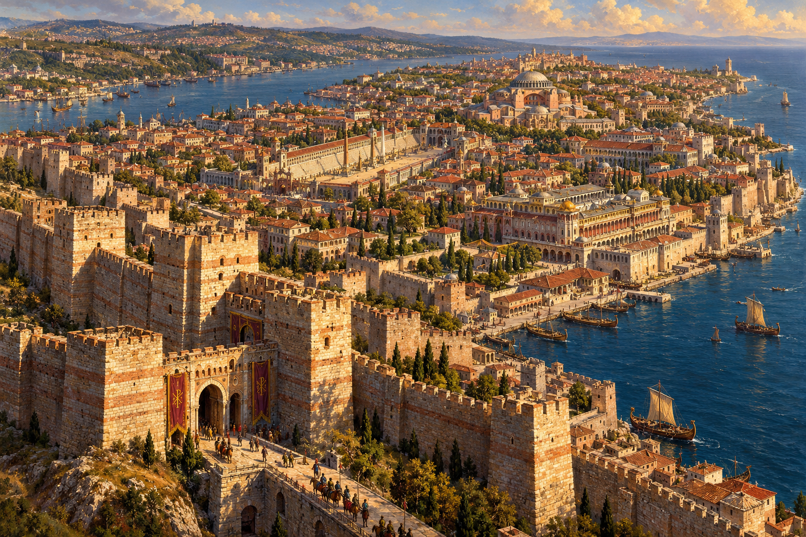
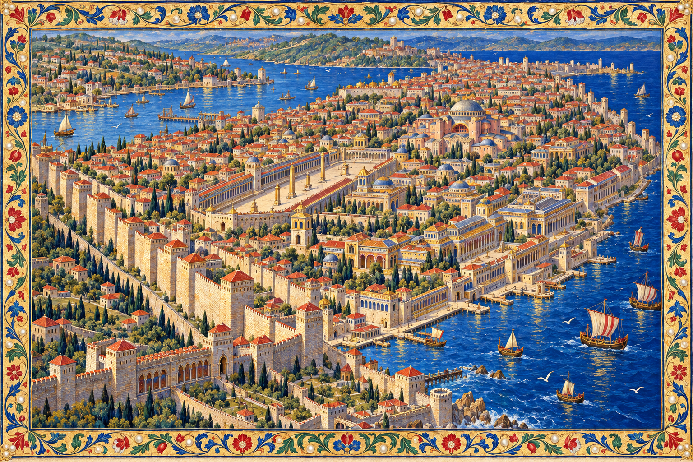
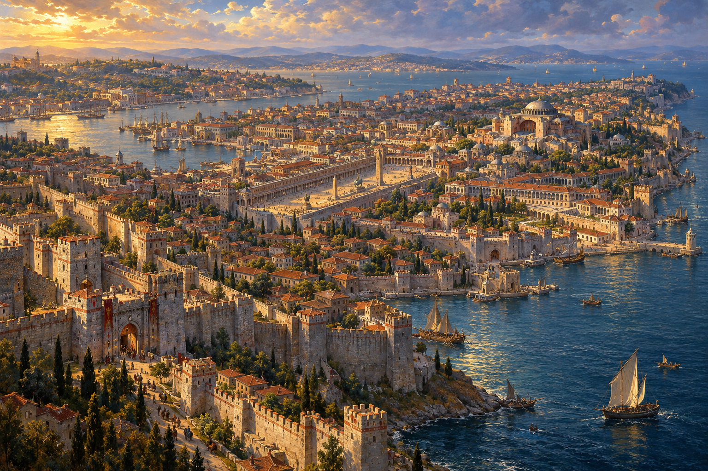

# ثلاث قراءات بصرية للقسطنطينية — الجولة الاستكشافية الأولى

**الأساس البحثي والإنتاجي معتمد؛ الهوية البصرية النهائية بانتظار قرار المالك.** هذه صور استكشاف فني لسنة 715م، وليست شهادة إعادة بناء أثري ولا أصولًا جاهزة للعبة.

## A — العظمة الإمبراطورية المعمارية

تقود الصورة كتلة السور وعمق البوابة، ثم طبقات الأحياء حتى آيا صوفيا. الضوء الجانبي يكشف وزن الحجر، والتفاصيل الصغيرة تساعد على الإحساس بالمقياس. هذا الاتجاه أقوى في الحضور المعماري والرهبة، وأهدأ في الزخرفة الخارجية.

**ملاحظة نقدية:** القصور المولّدة مركّبة وتحتاج مراجعة واجهاتها وتوزيعها، كما تحتاج العلاقة بين السور البري والتحصين البحري إلى ضبط. الحضور المعماري ناجح كآلية فنية، لكنه لا يثبت صحة كل تفصيلة مولّدة.

## B — الأطلس المُذهَّب المتقن

الأصباغ الزرقاء والخضراء والحمراء، والزخرفة النباتية، وإيقاع الماء والأسطح تجعل المدينة أقرب إلى صفحة مرسومة ثمينة. أُجري تعديل واحد على الصورة الأولى لتقوية أثر الرسم داخل المدينة وحذف الميداليات ذات الطيور الكبيرة. هذه النسخة المنقحة هي المقصودة بالمقارنة؛ الصورة الأولى محفوظة كمسودة فقط.

**ملاحظة نقدية:** الزخرفة تعبير فني حديث مستلهم من حِرفة المخطوطات، وليست دليلًا على زخرفة قصر بعينه سنة 715. ما زالت بعض الواجهات شديدة الانتظام وتحتاج تحريرًا معماريًا لاحقًا. يجب تقييم الصورة من داخل المدينة أيضًا، لا من الإطار وحده.

## C — الملحمة التاريخية المرسومة

يقودها الضوء الذهبي والهواء البحري، مع تراجع الأحياء في طبقات باردة ودافئة. السماء والماء جزء من التكوين، وتظل المدينة مقروءة داخل الجو. هذا الاتجاه أقوى في الإحساس بالعالم والمسافة والوقت.

**ملاحظة نقدية:** معالجة بعض أجزاء المدينة ما زالت حادّة نسبيًا قياسًا بالطموح إلى لوحة زيتية أكثر تعبيرًا. الأبراج الدقيقة وتجهيزات السفن والقصور تحتاج التدقيق نفسه؛ الجو الدرامي لا يعفيها من البحث.

## ما هو ثابت وما هو حر

الصور الثلاث تستهدف القسطنطينية من الجنوب الغربي، مع الأسوار البرية غربًا، والقرن الذهبي شمالًا، ومرمرة جنوبًا، وآيا صوفيا في النواة الشرقية، والميدان إلى جنوبها الغربي. حافظت الصور على هذه العلاقات العامة، لكنها ضغطت المسافات وأعادت تأليف الأحياء؛ ليست مخططات متطابقة أو خرائط أثرية مقيسة. لا توجد موافقة على معلم مولّد بوصفه الأصل الهندسي النهائي.

حُرّرت هذه الجولة من نسب الذهب وتكبير المعالم وقواعد تصغير أيقونات الهاتف. بقيت الممنوعات التاريخية قائمة. المسودات تؤسس الاختيار البصري فقط؛ لا يُعلن نجاح QA17 أو اختبارات الأداء أو اعتماد أسلوب رسمي.

## المصادر والأوامر والإنتاج

- [لوحة المراجع المرئية](reference-board.pdf): أربع صور مصدر حقيقية مع المصدر والحقوق وحدود الاستفادة؛ مصدر خامات خامس موثّق كرابط لأن رابط صورته غير متاح.
- [سجل المراجع وحقوق الاستخدام](reference-register.md)، مع نسخ المراجع المحلية في `references/`.
- [الأوامر الاستكشافية الثلاثة](concept-prompts.md)، والنصوص التي نُفِّذت حرفيًا داخل `prompts/`.
- الأداة المستخدمة: `image_gen.imagegen` المدمجة، توليد صور نقطية فعلي؛ ثلاث عمليات توليد وتعديل أسلوبي واحد لـB. لم تُستخدم بدائل HTML أو Canvas أو SVG.
- الصور النهائية الثلاث: PNG بحجم **1536×1024** لكل صورة. لا شفافية مطلوبة لهذه اللوحات.
- احتُفظ بالمستندات السبعة السابقة وأوامر A–E دون تغيير. جميع الإضافات داخل `prototypes/agent4-art-direction/exploration/`.

بوابة القرار الآن بصرية: أي اتجاه يعبّر عن هوية سيوف الممالك التي تريدها؟ وما العنصر الذي ينبغي تقويته أو استبعاده؟ لا أختار نيابة عن المالك، ولا أعتبر عدم الرد موافقة. أتوقف بعد هذا التسليم انتظارًا للمراجعة.
