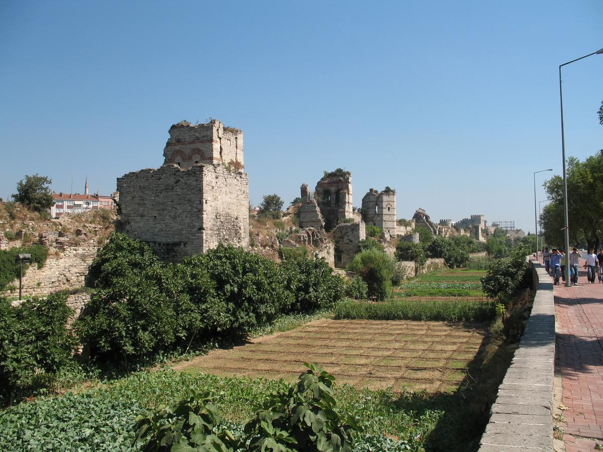
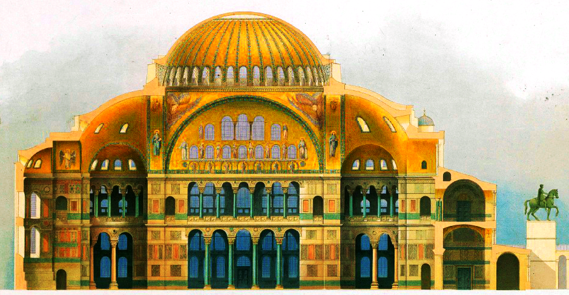
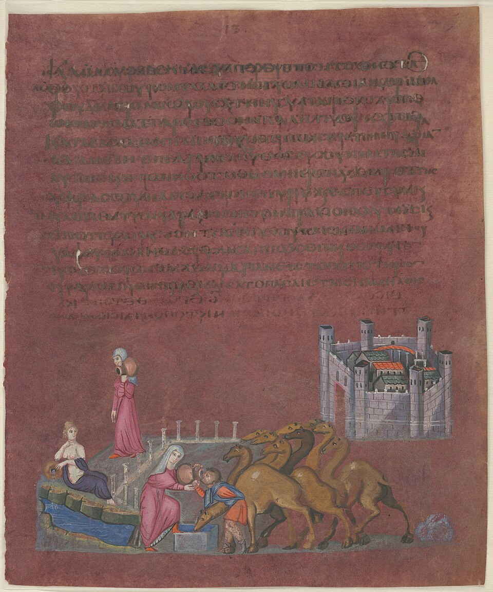
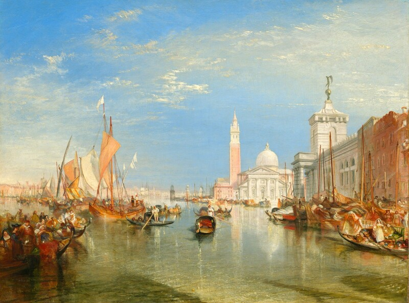

# Visual source board and reuse register

The downloadable visual board is `reference-board.pdf`. The four embedded reproductions below are real source images, inspected at source-image level and assembled without generative alteration. Sources were verified during this exploration. The Met material record is linked only because its advertised image endpoints returned 404; no substitute image was invented.

## R1 — Theodosian Walls

[Source record](https://commons.wikimedia.org/wiki/File:Theodosian_Walls_in_Constantinople_2.jpg) · CrniBombarder!!! / Wikimedia Commons · Modern photograph; uploaded 2006.

**Use:** Heavy masonry, brick bands, tower/curtain rhythm.

**Boundary:** Surviving/restored fabric is not a complete 715 state.

**Reuse:** Author-released public domain, per source page. Attribution is retained even where not compulsory. The rights statement applies to the identified reproduction, not every image on the hosting website.

## R2 — Hagia Sophia / Salzenberg plate

[Source record](https://commons.wikimedia.org/wiki/File:View_of_Haghia_Sophia,_plate_from_Wilhelm_Salzenbergs_Alt-Christliche_Baudenkmale_von_Constantinopel_vom_V._bis_XII._Jahrhundert_(alternate_version).png) · C. W. Kortum, W. Salzenberg et al., 1854 / Commons · Nineteenth-century architectural representation.

**Use:** Dome and supporting volumes; disciplined architectural drawing.

**Boundary:** Later depiction: not direct 715 evidence; reject later attachments.

**Reuse:** Public domain / PD-Art as marked on source page. Attribution is retained even where not compulsory. The rights statement applies to the identified reproduction, not every image on the hosting website.

## R3 — Vienna Genesis / Rebecca and Eliezer

[Source record](https://commons.wikimedia.org/wiki/File:ViennaGenesisPict13RebeccaEliezer.jpg) · Anonymous late antique illuminators; ONB scan / Commons · Sixth-century manuscript; modern digital reproduction.

**Use:** Precious pigment, patterned narrative space, assured fine drawing.

**Boundary:** A biblical scene, not Constantinople's street plan.

**Reuse:** Public domain / PD-Art as marked; no modern facsimile rights assumed. Attribution is retained even where not compulsory. The rights statement applies to the identified reproduction, not every image on the hosting website.

## R4 — Carved limestone capital

[Source record](https://www.metmuseum.org/art/collection/search/456089) · The Met, Rogers Fund 1909; 09.217.11 · Egypt, fifth-sixth century.

**Use:** Carved relief, material depth and precise shadows in stone.

**Boundary:** Egyptian comparator; not a capital proven to belong to Hagia Sophia.

**Reuse:** Public Domain / Met Open Access on object page. Attribution is retained even where not compulsory. The rights statement applies to the identified reproduction, not every image on the hosting website. Object metadata confirmed `isPublicDomain: true`; binary image unavailable in this package.

## R5 — Turner / Venice: The Dogana...

[Source record](https://www.nga.gov/artworks/1224-venice-dogana-and-san-giorgio-maggiore) · J. M. W. Turner, 1834; NGA, Widener Collection, 1942.9.85 · 1834 oil painting - TECHNIQUE ONLY.

**Use:** Marine light, luminous warm/cool intervals, atmospheric recession.

**Boundary:** Do not borrow Venetian buildings, gondolas or later sail rigs.

**Reuse:** Media marked public domain by the National Gallery of Art. Attribution is retained even where not compulsory. The rights statement applies to the identified reproduction, not every image on the hosting website.

## Translate the source into an original visual language

| Direction | Reference emphasis | Technique to pursue | Do not import |
|---|---|---|---|
| A | R1 masonry + R2 structural mass | Deep reveals, directional light on thick planes, monumental urban rhythm | Modern damage/roads or a nineteenth-century reconstruction treated as a complete 715 record |
| B | R3 manuscript handling + R2 rhythmic arcades | Fine brush drawing, precious opaque pigment and modern artist-designed gold/ornament | A literal biblical city, generated pseudo-script or a claim that every decorative motif is verified for 715 |
| C | R5 atmospheric painting + R1 grounded masonry | Glazes, warm/cool recession, scumbled air and selective impasto | Venetian buildings, later boats or an exact copy of Turner's composition |

Pigment names in the prompts describe color relationships, not chemical tests of these references. Gold-leaf and shell-gold language is a proposed artistic technique informed by the [Getty's manuscript-making discussion](https://www.getty.edu/art/exhibitions/making/); no Getty image is reproduced. The spectacular ornament of concept B is a contemporary atlas presentation, not historical evidence for a palace façade.

R1 includes modern surroundings and a distant minaret: they are visibly present in the reference and explicitly excluded from 715 art. R2 is a cutaway representation made in 1854, not a photograph of an eighth-century condition; its interior imagery and finishes require feature-level dating. R5 is entirely a later-period technique comparator. None of these images was passed as a generation reference; they informed prompt writing and human review. B's own generated first pass was the sole input to its later style-refinement edit.

## Rights and distribution boundaries

The downloaded source reproductions are retained with their own provenance; they are not game textures or generated content. R1's source records an author public-domain dedication. R2/R3 carry Commons PD-Art markings, whose source pages discuss jurisdictional qualifications; those marks are reported, not expanded into a universal legal guarantee. R5 is explicitly public domain on the holding museum's object page. No copyrighted contemporary reconstruction or commercial-game art has been incorporated. Re-check any newly substituted source rather than inheriting another file's status. The generated concept files are separately identified as AI-generated explorations; the public-domain status of references does not establish copyright status for generated output.
